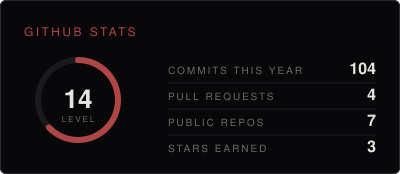
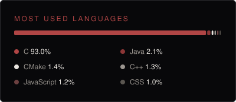
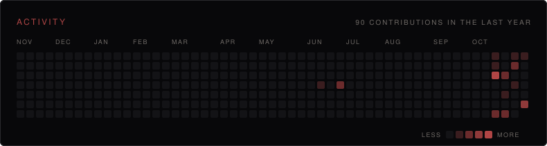

  

 

I'm a third-year computer science student at USTHB. I like building things from start to finish: websites, games, apps . What pulls me in most is what happens underneath, how code turns into something a machine actually runs.

 

<b>Languages</b> 
       

<b>Web</b> 
  

<b>Desktop & libraries</b> 
  

<b>Data</b> 
 

<b>Tools</b> 
  

  
  

  

