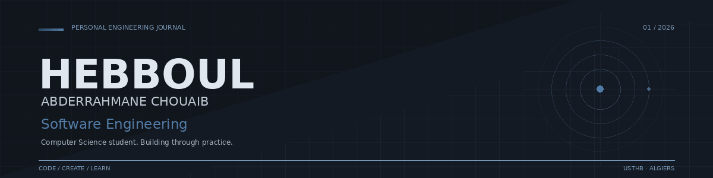

  

  PERSONAL ENGINEERING JOURNAL · USTHB · ALGIERS

---

## 01 / Introduction

I'm a Computer Science student at USTHB with a growing interest in software engineering and development.

I enjoy building things, exploring new technologies, and understanding the ideas behind the software I work on. Most of my learning comes from hands-on projects, experimenting with different tools, and collaborating with others.

I'm still figuring out which areas of software engineering I want to specialize in, and I see that as an opportunity to keep exploring, improving, and taking on new challenges.

## 02 / Selected Work

### GitHub Profile Screening Tool
A collaborative Python application developed within Shellmates to evaluate GitHub profiles against configurable criteria. It retrieves profile data through GitHub's REST and GraphQL APIs, applies a scoring system, and presents eligibility results through an interactive Streamlit dashboard.

**Technologies:** Python · Streamlit · GitHub REST API · GraphQL · Pytest

[Repository](https://github.com/hebboulchouaib/github-tool-chouaib) · [Live Demo](https://profile-analyzer-app.streamlit.app/)

### Library Management System
An individual project developed in two implementations: a Java desktop application using JavaFX and Oracle Database, followed by a web version built with HTML, CSS, JavaScript and Supabase. Both versions provide tools for managing books, students, loans and returns.

**Technologies:** Java · JavaFX · JDBC · Oracle · HTML · CSS · JavaScript · Supabase

[Desktop Version](https://github.com/hebboulchouaib/library-management-java-app) · [Web Version](https://github.com/hebboulchouaib/library-management-web-app) · [Live Demo](https://hebboulchouaib.github.io/library-management-web-app/)

### 2048 — SDL2 Game
An individual recreation of the classic 2048 puzzle game, built in C using SDL2. Features three game modes: manual play, automated machine play, and player versus machine.

**Technologies:** C · SDL2 · SDL2_ttf

[Repository](https://github.com/hebboulchouaib/C-SDL2-2048-slide-game)

## 03 / Toolkit

**Languages**

`C` · `Java` · `Python` · `JavaScript` · `SQL` · `HTML` · `CSS`

**Frameworks & Libraries**

`SDL2` · `SDL2_ttf` · `JavaFX` · `JDBC`

**Databases**

`Oracle Database` · `Supabase`

**Tools & Environment**

`Git` · `GitHub` · `Linux` · `Streamlit`

## 04 / Activity

Building, experimenting, and learning through projects.

My GitHub activity reflects my ongoing journey in software development, from individual projects to collaborative work.

## 05 / Connect

I'm always open to connecting with developers, collaborating on interesting projects, and exploring new opportunities.

- [Portfolio](https://hebboulchouaib.github.io/portfolio_website/)
- [LinkedIn](https://www.linkedin.com/in/chouaib-hebbeboul/)
- [GitHub](https://github.com/hebboulchouaib)

---

  CODE · CREATE · LEARN

